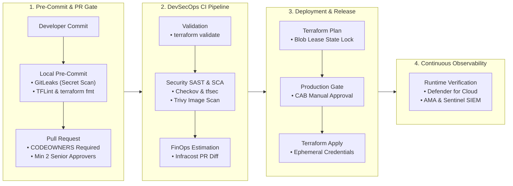
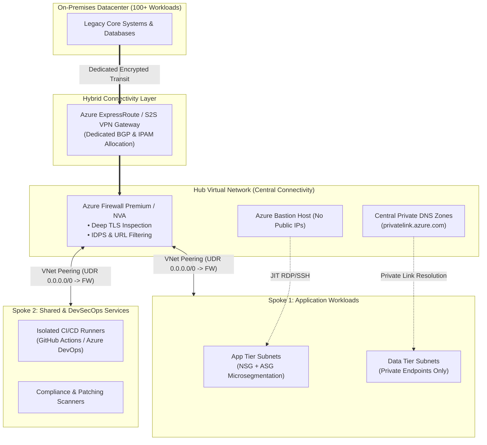
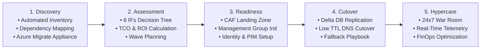
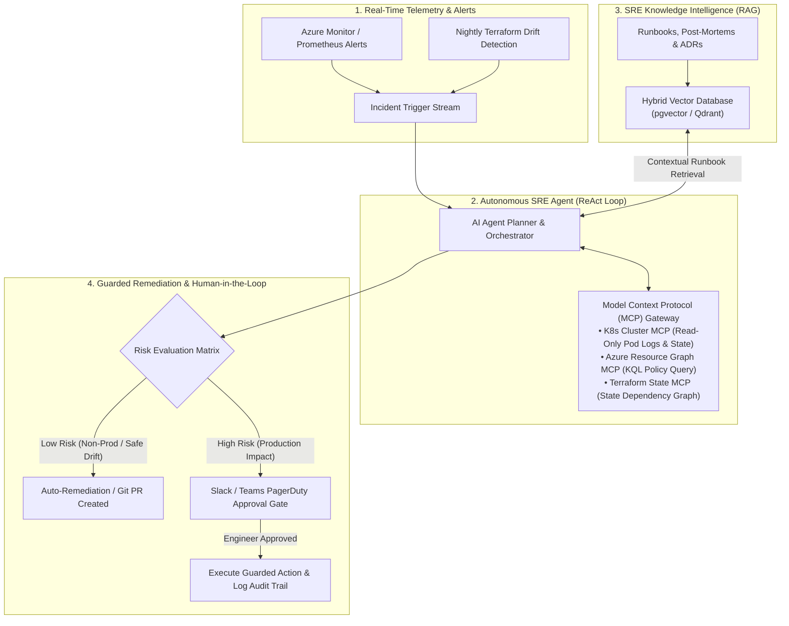

<div align="center">

  <!-- Header Banner (Exact Match with Vishal Kumar) -->
  

  <!-- Cyan Subtitle Line (Exact Match to Reference Image) -->
  <p align="center">
    
  </p>

  <!-- Title / Emoji Line (Exact Match to Reference Image) -->
  <h3 align="center">🔐 Senior DevSecOps Engineer &amp; Cloud Architect | Agentic AI Systems</h3>

  <!-- Tagline / Core Disciplines (Exact Match to Reference Image) -->
  <p align="center">
    <strong>Enterprise Cloud Infrastructure • Zero-Trust Security • GitOps Automation • Autonomous SRE</strong>
  </p>

  <!-- Stacked Action Badges (Exact Centered Pyramid Layout from Reference Image) -->
  <p align="center">
    <a href="https://linkedin.com/in/vishalkumar-devops">
      
    </a>
  </p>
  <p align="center">
    <a href="https://github.com/vishalkumar-devops?tab=repositories">
      
    </a>
  </p>
  <p align="center">
    
  </p>

  <br />

</div>

---

## 🧭 Executive Summary & Senior Architectural Mindset

> *"Security is not a gate at the end of delivery; it is the foundation upon which resilient enterprise platforms are engineered."*

Welcome! I am **Vishal Kumar**, an **AI-Native Senior DevSecOps Engineer & Cloud Platform Architect** driven by an **architect-level systems engineering mindset**. While others focus merely on script syntax, I bridge the gap between **high-velocity business delivery**, **uncompromising enterprise governance**, and **next-generation AI automation (MCP, RAG & Autonomous SRE Agents)**. 

My core focus centers on architecting **Cloud Adoption Framework (CAF) Landing Zones**, engineering **shift-left security pipelines**, spearheading **zero-downtime multi-tier cloud migrations (100+ workloads)**, embedding **FinOps guardrails**, and engineering **Agentic AI Infrastructure** that eliminates operational toil.

```
                              [ The Enterprise Mindset ]
                                          │
                     "What is the Business & Functional Domain?"
                                          │
            ┌─────────────────────────────┴─────────────────────────────┐
            │                                                           │
[ Infrastructure Design & Platform Engineering ]         [ Application & AI System Architecture ]
 • Azure CAF Landing Zones & Hub-Spoke Networks           • Microservices, Mesh & Zero-Trust Auth
 • DevSecOps Shift-Left & Infrastructure as Code         • Model Context Protocol (MCP) Tooling
 • 100+ Workload Enterprise Cloud Migration              • RAG Pipelines for SRE Runbook Search
 • FinOps, Compliance, DR & Policy Guardrails            • LLMOps, Private vLLM Serving & Gateways
```

### 🎯 IT Career Tracks & Enterprise Value Alignment

True architectural leadership requires bridging the gap between business strategy, pre-sales solutioning, and technical execution:

```
┌────────────┐       ┌───────────────┐       ┌─────────┐       ┌──────────────────────┐       ┌────────────────┐
│   Sales    │ ────> │   Pre-Sales   │ ────> │   TAM   │ ────> │ Enterprise Architect │ ────> │ Technical Lead │
│ Commercial │       │ Techno-       │       │ Tech    │       │ Infra + Application  │       │ Infra / App    │
│ Focus      │       │ Proposals     │       │ Account │       │ Strategy & Design    │       │ Execution      │
└────────────┘       └───────────────┘       └─────────┘       └──────────────────────┘       └────────────────┘
```

* **Pre-Sales & Techno-Functional Solutioning:** Crafting high-converting RFPs/RFIs, cloud TCO/ROI models, proof-of-concept (POC) architectures, and executive presentations.
* **Technical Account Strategy (TAM):** Trusted architectural governance, operational risk reviews, escalation mitigation, and long-term cloud health.
* **Enterprise Cloud Architecture:** Holistic technology blueprint spanning Landing Zones, Zero-Trust networking, security posture, and application modernization.
* **Technical Delivery Leadership:** Hands-on sprint execution, IaC pull request enforcement, automated quality gates, and team mentorship.

### 💎 The Pillars of Professional Distinction ("Standing Out")
* **Impact-Driven Delivery:** Quantifying achievements with tangible business metrics (*"Migrated 100+ enterprise workloads with zero downtime and slashed cloud spend by 28%"*).
* **Production-Grade Codebase:** Publishing reusable, parameterized Terraform modules, hardened CI/CD templates, and documented Reference Architectures.
* **Architectural Thought Leadership:** Authoring Architecture Decision Records (ADRs), post-mortems, and conducting knowledge transfer (KT) sessions.

---

## 🏛️ The 10 Pillars of Enterprise Scale & Resilience

Every architecture I design is governed by 10 non-negotiable enterprise quality pillars:

| # | Pillar | Architectural Enforcement Strategy |
| :---: | :--- | :--- |
| **01** | **Scalable** | Horizontal auto-scaling with VMSS & AKS HPA, multi-zone compute, stateless app tiers. |
| **02** | **Robust** | Circuit breakers, automated retry policies, self-healing orchestration, graceful degradation. |
| **03** | **Secure** | Zero-Trust architecture, identity isolation, microsegmentation, customer-managed keys (CMK). |
| **04** | **Reliable** | Active-passive regional failover, Azure Site Recovery (ASR), 99.99% SLA targets. |
| **05** | **Portable** | Modular Terraform modules, standardized OCI containers, cloud-agnostic Helm charts. |
| **06** | **Governed** | Azure Policy initiatives (CIS Benchmarks, NIST SP 800-53) enforced at Root Management Group. |
| **07** | **High Avail** | Multi-Availability Zone redundancy (ZRS), Azure Front Door with active health probes. |
| **08** | **Cost-Optimized** | Unit-cost metrics, automated rightsizing, off-hours shutdown, Infracost pull request gates. |
| **09** | **Backed Up** | Immutable geo-redundant backups (GRS), snapshot lifecycle policies, automated DR drill runs. |
| **10** | **Compliant & Monitored** | Central Log Analytics Workspace, Azure Monitor Agent (AMA), Data Collection Rules (DCR). |

---

## 📐 Enterprise Architecture Blueprints

### 1. Shift-Left DevSecOps CI/CD Delivery Pipeline

Security scans and compliance gates are integrated directly into the developer workflow. No uninspected code, unverified secret, or unapproved infrastructure change ever reaches production.



#### 🛡️ DevSecOps & Terraform Engineering Standards
* **Remote State Security:** Remote state stored in private Azure Storage Account with blob lease locking, customer-managed key (CMK) encryption at rest, and accessed exclusively via Managed Identities with least-privilege RBAC.
* **Semantic Modularity:** Parameterized, reusable Terraform modules with strict semantic versioning (`v1.2.0`) and comprehensive input validation blocks.
* **Automated Drift Detection:** Scheduled nightly pipelines running `terraform plan -detailed-exitcode` to catch out-of-band console changes and trigger immediate alerts.
* **Branch Governance & Policies:**
  * Trunk-based branching model (`main`, `feature/*`, `hotfix/*`).
  * Mandatory Pull Request policies with minimum 2 senior approvals.
  * Strict `CODEOWNERS` sign-off on core infrastructure modules.
  * Direct push and branch deletion strictly blocked on protected branches.
  * Automated rollback strategy with tested revert workflows.

---

### 2. Enterprise Hub-and-Spoke Zero-Trust Network Topology

Centralized traffic inspection, zero overlapping CIDR ranges, private-only endpoints for all PaaS services, and explicit perimeter defense.



---

### 3. End-to-End Enterprise Cloud Migration Strategy (100+ Applications)

Proven five-stage enterprise migration blueprint taking legacy on-premises workloads into fully managed, secure cloud environments with zero data loss.



---

### 4. Autonomous Agentic SRE & RAG Architecture (AIOps & MCP)

Bridging cloud telemetry, vector search, and LLM agent reasoning to eliminate operational toil, automate drift remediation, and achieve sub-minute incident response.



#### 🧠 Agentic AI, MCP & RAG Pillars
* **Model Context Protocol (MCP) Integration:** Engineering standardized MCP servers that grant AI agents safe, read-only tools to query Kubernetes pods, Azure Resource Graph, and Terraform states without granting raw API keys or destructive privileges.
* **Retrieval-Augmented Generation (RAG) for SRE Diagnostics:** Enterprise runbooks, past incident post-mortems, and architectural decision records (ADRs) are vectorized in **pgvector / Qdrant**. When an incident fires, the agent retrieves the exact troubleshooting sequence within milliseconds, slashing MTTR.
* **Autonomous Drift & CVE Triage Agents:** ReAct-based agents parse scheduled drift alerts and Trivy CVE scans, analyze whether vulnerabilities are exploitable (EPSS scoring), and automatically generate pull requests with corrective Terraform patches.
* **Enterprise LLMOps & Guardrails on Kubernetes:** Hosting private models (Llama 3, DeepSeek) using **vLLM** on Azure Kubernetes Service (AKS) with GPU autoscaling, backed by an **AI Gateway** enforcing rate-limiting, token budget limits, and OWASP Top 10 for LLMs prompt injection defenses.

---

## 🏢 Enterprise Governance, Identity & Management Hierarchy

Following Microsoft's **Cloud Adoption Framework (CAF)**, organizational subscriptions are structured hierarchically to contain blast radiuses, simplify cost accounting, and enforce strict regulatory compliance.

```
                              [ Microsoft Entra ID Tenant ]
                                            │
                                [ Tenant Root Group ]
                                            │
        ┌───────────────────────────────────┼───────────────────────────────────┐
        │                                   │                                   │
[ Platform Management Group ]   [ Landing Zones Management Group ]   [ Decommissioned & Sandboxes ]
   ├── Identity (Domain/DNS)       ├── Corp (Internal-Only VNets)       ├── Developer Sandbox MG
   ├── Management (LogAnalytics)   ├── Online (Public DMZ / WAF)        └── Decommissioned Archive
   └── Connectivity (Hub/Firewall) ├── Dev Subscriptions
                                   ├── UAT Subscriptions
                                   └── Production Subscriptions
```

### Governance Best Practices
* **Subscription Isolation:** Strict functional and environmental boundaries (`Dev`, `UAT`, `Prod`, `Platform`) ensuring non-production incidents never cascade into production.
* **Azure Policy Initiatives:** Enterprise baselines (CIS Azure Foundations, MCSB, NIST) deployed at root Management Group level with automated remediation and time-bound exemptions.
* **Privileged Identity Management (PIM):** Zero standing access for admin roles; all elevated privileges require multi-factor authentication, business justification, and peer approval.

---

## 🛡️ Multi-Layered Defense-in-Depth Security Matrix

| Security Layer | Architecture Controls & Implementation Technologies |
| :--- | :--- |
| 🪪 **Identity & Access** | Microsoft Entra ID, Conditional Access policies, Privileged Identity Management (PIM), Managed Identities (No stored credentials), Multi-Factor Authentication (MFA). |
| 🌐 **Network Security** | Hub-and-Spoke architecture, microsegmentation via NSGs/ASGs, Azure Firewall Premium with TLS inspection, Private Link / Endpoints, Azure DDoS Protection. |
| ⚖️ **Governance & Compliance** | Root Azure Policy initiatives (CIS Benchmarks, ISO 27001, HIPAA), Microsoft Defender for Cloud Secure Score tracking, automated compliance reporting. |
| 💻 **Compute & Workload** | Microsoft Defender for Servers, automated CIS OS baselines, Customer Managed Keys (CMK) disk encryption, immutable container base images, Trivy vulnerability scans. |
| 🔐 **Data Protection** | Encryption at rest (AES-256) and in transit (TLS 1.3), Key Vault with HSM protection, Automated Purview data discovery and classification. |

---

## 💰 FinOps & Cloud Cost Engineering Playbook

Cloud engineering without cost discipline is incomplete. I implement continuous FinOps automations to drive maximum ROI per cloud dollar spent:

<div align="center">

```
  [ Detect & Eliminate Waste ] ──> [ Rightsizing Workloads ] ──> [ Commitment Discounts ] ──> [ Observability Tuning ]
  • Unattached Managed Disks        • 95th Percentile CPU/RAM       • 1 & 3-Year Reserved Instances • Data Collection Rules (DCR)
  • Stale & Orphaned Snapshots      • Convert to Burstable Tiers    • Azure Savings Plans (65%+)    • Filter Noisy Diagnostic Logs
  • Unassociated Public IPs         • Automated Off-Hours Stops     • Spot Instances for Batch Jobs • Archive Tier for Long-Term Data
```

</div>

* **Automated Cloud Janitor:** Event-driven serverless functions to identify and purge unattached disks, unassociated public IPs, and expired snapshots.
* **Infracost in CI/CD:** Pull requests automatically calculate exact delta costs before infrastructure changes are merged.
* **Telemetry Cost Ingestion Filtering:** Fine-tuned Data Collection Rules (DCR) on Azure Monitor Agent to capture only actionable telemetry, cutting unnecessary Log Analytics ingestion bills.

---

## 🔄 Business Continuity, High Availability & Disaster Recovery

Ensuring system survivability against regional outages and data corruption:

* **Storage Resilience Strategy:**
  * **LRS (Locally Redundant Storage):** Triple redundancy within a single datacenter for transient workloads.
  * **ZRS (Zone-Redundant Storage):** Multi-zone replication across 3 independent availability zones within a primary region.
  * **GRS (Geo-Redundant Storage):** Asynchronous replication to a secondary paired region for mission-critical archives.
* **Compute High Availability:** Virtual Machine Scale Sets (VMSS) and AKS worker nodes distributed evenly across three Availability Zones with automated health probe recovery.
* **RTO & RPO Targets:**
  * **Recovery Time Objective (RTO):** `< 60 minutes` via automated Azure Site Recovery (ASR) orchestration and Infrastructure as Code re-deployment.
  * **Recovery Point Objective (RPO):** `< 15 minutes` via geo-replicated database backups and continuous log shipping.

---

## 📡 Enterprise Observability, Telemetry & Incident Escalation

High availability is meaningless without actionable visibility. Telemetry is engineered around cost-efficiency, source-level filtering, and rapid incident response:

```
[ Workload Infrastructure / AKS / Hybrid VMs ]
                      │
                      ▼ (Source-Filtered via Data Collection Rules - DCR)
        [ Azure Monitor Agent (AMA) ]
                      │
                      ▼ (Granular Ingestion & Retention Tiers)
     [ Central Log Analytics Workspace (LAW) ]
                      │
           ┌──────────┴──────────┐
           ▼                     ▼
   [ Alert Processing ]   [ Security Analytics ]
   (Dynamic Action Group) (Defender for Cloud & Sentinel)
           │
           ├──> PagerDuty (P1/P2 Critical Incidents)
           ├──> Microsoft Teams / Slack (Operational Alerts)
           └──> Azure Logic Apps (Automated Self-Healing Runbooks)
```

* **Centralized Log Analytics Workspace (LAW):** Dedicated workspace per enterprise landing zone with automated 30-day interactive and 365-day archive lifecycle policies.
* **Source-Filtered Ingestion with AMA & DCR:** Windows Event logs and Linux Syslogs filtered at the agent source via Data Collection Rules (DCR), preventing runaway diagnostic log costs.
* **Dynamic Action Group Routing:** Tiered alert policies routing critical incidents dynamically to PagerDuty or Microsoft Teams with automated runbook triggers for self-healing.

---

## 🛠️ Production Tech Stack & Tooling Radar

<div align="center">

### Cloud Platforms & Architecture
<p>
  
  
  
  
</p>

### Infrastructure as Code & Configuration
<p>
  
  
  
  
</p>

### DevSecOps & Shift-Left Security
<p>
  
  
  
  
  
  
</p>

### Containers, Orchestration & GitOps
<p>
  
  
  
  
  
</p>

### CI/CD, Scripting & Observability
<p>
  
  
  
  
  
  
</p>

### 🤖 AI, LLMOps & Agentic Infrastructure
<p>
  
  
  
  
  
  
  
  
</p>

</div>

---

## 🚀 Featured Enterprise Architecture Repositories

<table>
  <tr>
    <td width="50%">
      <h3>🤖 <a href="https://github.com/vishalkumar-devops/sre-agent-mcp-rag">sre-agent-mcp-rag</a></h3>
      <p>Autonomous SRE & DevSecOps Agent powered by the Model Context Protocol (MCP) and hybrid RAG. Connects live Kubernetes cluster logs, Azure Resource Graph queries, and internal runbooks in Qdrant to automate root-cause analysis and drift remediation.</p>
      <p>
        
        
        
      </p>
    </td>
    <td width="50%">
      <h3>🛡️ <a href="https://github.com/vishalkumar-devops/llmops-k8s-ai-gateway">llmops-k8s-ai-gateway</a></h3>
      <p>Hardened enterprise LLM serving platform on Azure Kubernetes Service (AKS). Features private vLLM model inference, prompt injection defenses, PII masking, token usage quota enforcement (FinOps for AI), and multi-provider failover routing.</p>
      <p>
        
        
        
      </p>
    </td>
  </tr>
  <tr>
    <td width="50%">
      <h3>🏛️ <a href="https://github.com/vishalkumar-devops/enterprise-azure-landingzone-terraform">enterprise-azure-landingzone-terraform</a></h3>
      <p>Production-grade Microsoft CAF Landing Zone built with modular Terraform. Features Management Group hierarchy, Hub-and-Spoke networking, Azure Firewall Premium rules, and automated nightly drift detection pipelines.</p>
      <p>
        
        
        
      </p>
    </td>
    <td width="50%">
      <h3>🛡️ <a href="https://github.com/vishalkumar-devops/zero-trust-devsecops-pipeline">zero-trust-devsecops-pipeline</a></h3>
      <p>Reusable DevSecOps pipeline template suite for GitHub Actions & Azure DevOps. Integrates GitLeaks secret scanning, Trivy container security, Checkov IaC posture analysis, and Infracost PR budget gates.</p>
      <p>
        
        
        
      </p>
    </td>
  </tr>
  <tr>
    <td width="50%">
      <h3>☸️ <a href="https://github.com/vishalkumar-devops/hardened-aks-gitops-cluster">hardened-aks-gitops-cluster</a></h3>
      <p>Zero-trust Azure Kubernetes Service deployment with Cilium eBPF network microsegmentation, Azure Key Vault Secrets Store CSI driver, Kyverno admission policies, and declarative ArgoCD GitOps reconciliation.</p>
      <p>
        
        
        
      </p>
    </td>
    <td width="50%">
      <h3>💰 <a href="https://github.com/vishalkumar-devops/finops-cloud-cost-optimizer">finops-cloud-cost-optimizer</a></h3>
      <p>Automated cloud waste remediation engine. Serverless automation scripts detecting orphaned disks, obsolete snapshots, unassociated IPs, and auto-scheduling non-production cluster scale-downs to zero off-hours.</p>
      <p>
        
        
        
      </p>
    </td>
  </tr>
</table>

---

## 🤝 Leadership, Governance & Vendor Delivery Framework

Senior engineering goes beyond writing manifests — it requires clear ownership, technical delivery governance, and cross-functional alignment.

### Delivery RACI Matrix

```
┌─────────────────────────────────┬─────────────┬─────────────┬─────────────┬─────────────┐
│ Delivery Milestone              │ Responsible │ Accountable │  Consulted  │  Informed   │
├─────────────────────────────────┼─────────────┼─────────────┼─────────────┼─────────────┤
│ CAF Architecture Blueprint      │ Lead Arch   │ VP Eng      │ SecOps      │ Dev Teams   │
│ IaC Module Implementation       │ DevSecOps   │ Lead Arch   │ SRE / QA    │ Product     │
│ Security & Compliance Sign-Off  │ SecOps      │ CISO        │ DevSecOps   │ Governance  │
│ Cutover & Migration Window      │ Cloud Team  │ Lead Arch   │ DBAs / Apps │ Exec Stake  │
│ FinOps Budget Variance Audit    │ FinOps Lead │ Lead Arch   │ Procurement │ Finance Ops │
└─────────────────────────────────┴─────────────┴─────────────┴─────────────┴─────────────┘
  R: Responsible (Executes) | A: Accountable (Approves) | C: Consulted (Advises) | I: Informed (Notified)
```

### Procurement & Vendor Lifecycle
```
[ RFI (Request for Information) ]
               │
[ RFP (Request for Proposal & Architecture Scoping) ]
               │
[ Technical Evaluation Matrix (Security, Compatibility, Cost, SLA) ]
               │
[ Statement of Work (SOW) & Milestone Sign-Off ]
               │
[ Knowledge Transfer (KT), Runbook Handover & Hypercare ]
```

---

## 📈 GitHub Telemetry & Activity

<div align="center">
  <table border="0">
    <tr>
      <td align="center" width="50%">
        
      </td>
      <td align="center" width="50%">
        
      </td>
    </tr>
  </table>

  <br />

  
</div>

---

## 📬 Let's Build Something Resilient Together!

Whether you are looking to audit your cloud security posture, design an enterprise Landing Zone, streamline CI/CD delivery, or execute a complex multi-workload migration:

<div align="center">

[](https://linkedin.com/in/vishalkumar-devops)
&nbsp;&nbsp;&nbsp;&nbsp;
[](mailto:vishalgupta97711@gmail.com)
&nbsp;&nbsp;&nbsp;&nbsp;
[](https://github.com/vishalkumar-devops)

<br />

```
"Quality is not an act, it is a habit. Automate relentlessly, secure proactively, and build for scale."
```


</div>
